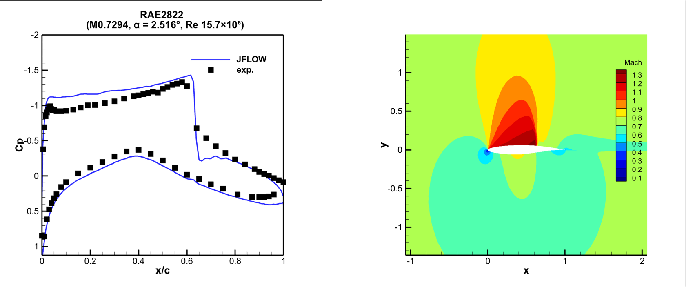
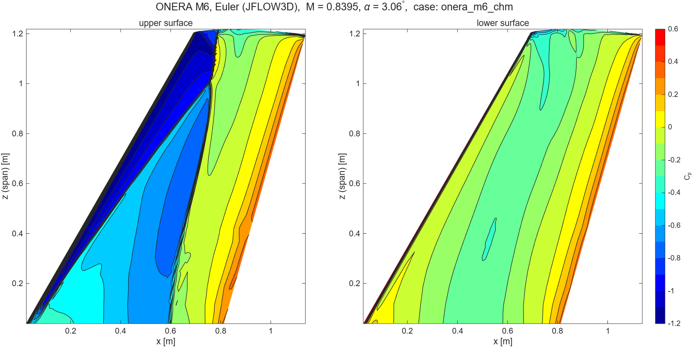
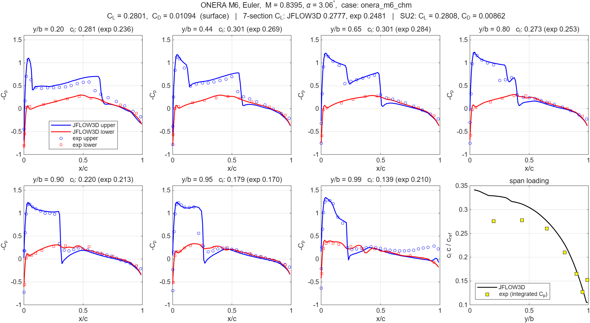
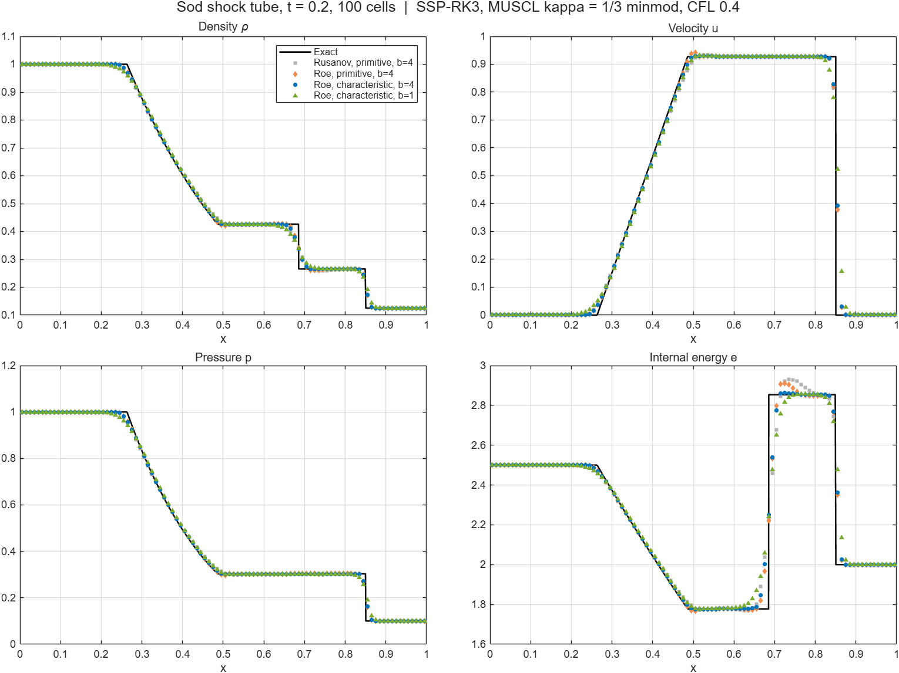
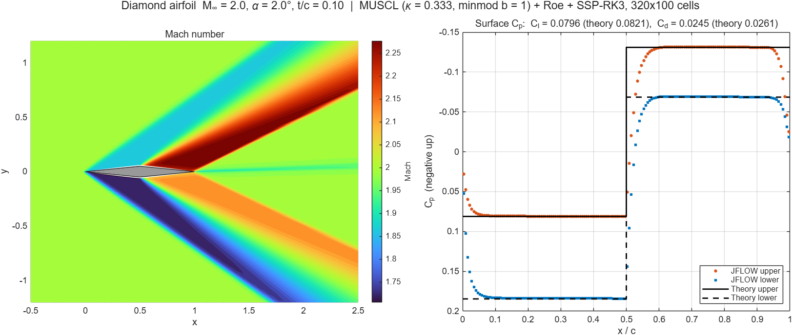

# JFLOW

2D and 3D compressible Euler solvers — cell-centered finite volume on structured curvilinear grids, written in Fortran.
Reads PLOT3D grids (e.g. from Pointwise).



## Features

- Riemann solvers: Rusanov, Roe (Harten entropy fix in 3D)
- MUSCL (κ-scheme, minmod) with characteristic-variable reconstruction
- SSP-RK3 time integration, local time stepping for steady flows; implicit LU-SGS in 3D
- BCs: slip wall, symmetry, supersonic inlet, outlet, Riemann-invariant farfield
- Automatic C-grid wake cut / O-grid seam detection (3D: also faces between blocks)
- 3D: multi-block grids, restart / periodic saves / STOP file, Tecplot binary (.plt) output
- OpenMP

## Build & run

```
build.bat release omp
.\main.exe <case folder>
```

A case folder contains `grid.in` and `flow.in`. Results are written to the same folder:
`<output>_result.dat` (Tecplot), `<output>_line.dat`, `<output>_residual.dat`.

## Input

`grid.in`
```
$block-1 = airfoil.x            # PLOT3D file, or: cartesian ni nj xmin xmax ymin ymax
$form-1  = 1                    # 0 binary, 1 ASCII
$bc-1-3  = 110 49 305           # face (1 imin, 2 imax, 3 jmin, 4 jmax) = code [node range]
$bc-1-4  = 200 freestream
$output  = airfoil
```
BC codes: `110` wall, `200` farfield, `210` inlet, `220` outlet, `300` symmetry.
Faces without a BC are connected automatically if they coincide with another face.

`flow.in`
```
$steady   = 1                   # 1 steady, 0 unsteady ($t_end)
$max_iter = 40000
$res_tol  = 1.0e-5
$local_dt = 1
$cfl      = 0.8
$sigma    = 1                   # 0 first order, 1 MUSCL
$kappa    = 0.3333333333333333
$b        = 1                   # minmod compression
$flux     = roe                 # rusanov | roe
$state-freestream = 1.0  0.7287  0.0320  0.7142857142857143    # rho u v p
$initial  = freestream
```
Nondimensionalization: ρ = 1, p = 1/γ → speed of sound 1, so `u = M cos α`, `v = M sin α`.
All keys are listed at the top of [src/case_setup.f90](src/case_setup.f90).

## Example: Sod shock tube

`grid.in`
```
$block-1 = cartesian 101 21 0.0 1.0 0.0 0.2
$bc-1-1  = 220
$bc-1-2  = 220
$bc-1-3  = 220
$bc-1-4  = 220
$output  = sod
```

`flow.in`
```
$steady   = 0
$t_end    = 0.2
$cfl      = 0.4
$line_row = 10
$sigma    = 1
$kappa    = 0.3333333333333333
$b        = 1
$flux     = roe
$state-left  = 1.0    0.0  0.0  1.0
$state-right = 0.125  0.0  0.0  0.1
$initial  = right
$region-1 = left  *  0.5  *  *
```

## 3D solver

A 3D version lives in [src3d/](src3d/) next to the unchanged 2D code: same scheme
(MUSCL + Rusanov/Roe + SSP-RK3, local time stepping), same BCs and input format.

```
build.bat 3d release omp
.\main3d.exe cases3d\sod
```

Differences from 2D input:

- `grid.in`: `$dim = 3`; faces 1–6 (`5 kmin`, `6 kmax`); a BC range is four node numbers
  `a1 a2 b1 b2` along the face (faces 1,2: j k / 3,4: i k / 5,6: i j);
  `cartesian ni nj nk xmin xmax ymin ymax zmin zmax`
- `$extrude-1 = nk span` turns a 2D PLOT3D file into a 3D grid (use `300` on faces 5, 6 for a quasi-2D run)
- `flow.in`: states are `rho u v w p`, or by Mach number and angles:
  `$state-freestream = mach 0.8395 alpha 3.06 [beta 0] [rho 1] [p 0.714…]` (`speed V` instead of `mach`;
  `$lift_axis = y | z` sets the axis α tilts toward); regions are `name x0 x1 y0 y1 z0 z1`; `$line_block`, `$line_k` pick the line output

Multi-block grids (point-matched): one multi-block PLOT3D file with a single `$block-1 = file` line,
or one `$block-n = file [m]` line per block. BCs are given per block (`$bc-n-f`);
faces between blocks are found and connected automatically, like wake cuts.

Long runs:
- `$restart = 1` continues from `<output>_restart.bin` (written at the end and every `$save_interval` iterations)
- create a file named `STOP` in the case folder to end the run cleanly (results are saved)
- the screen shows time per iteration and time left

Time integration: `$time_scheme = explicit` (SSP-RK3, default) or `implicit` (LU-SGS, steady only).
LU-SGS works best with `$cfl = 5–10` (≈5× faster than explicit to 1e-4 on the extruded NACA 0012 case);
`$lusgs_omega` (default 1) adds diagonal dominance.

Roe entropy fix (Harten): `$entropy_fix = 0.1` (δ = 0.1 c̃, default 0 = off),
`$entropy_fix_waves = acoustic | all` (u ± c only, or also u for stagnation points).

Output `<output>_result.plt` (Tecplot binary, one zone per block: x y z + rho u v w p Mach, cell-centered);
`$output_format = ascii | both` for `.dat`. `tools/read_jflow3d.m` reads either in MATLAB.
`cases3d/` holds the Sod tube and the NACA 0012 extruded case, both of which reproduce the 2D results.

### ONERA M6 wing

M 0.8395, α 3.06°, Euler — 151×101×121 C-O grid (1.8 M cells), Roe + MUSCL (b = 4), 20000 iterations.
The lambda shock on the upper surface is captured; section Cp vs. Schmitt & Charpin (AGARD AR-138).





| | C_L | C_D |
|---|---|---|
| JFLOW3D (surface pressure integral) | 0.2801 | 0.01094 |
| SU2 Euler (JST, 108k nodes, regression test value) | 0.2808 | 0.00862 |
| Experiment (7 sections, integrated Cp) | 0.2481 | – |

Reference area: half-wing planform 0.7530 m².

## Results

RAE 2822, M 0.7294, α 2.516° — Euler vs. Airbus pETW experiment ([NWTF](https://www.nwtf.ac.uk/dataset/2687/)), top figure.

Sod shock tube, 100 cells — primitive vs. characteristic reconstruction.



Diamond airfoil, M 2.0, α 2° — vs. shock-expansion theory.



Underexpanded planar jet in supersonic coflow.


Convergence with global vs. local time step.


