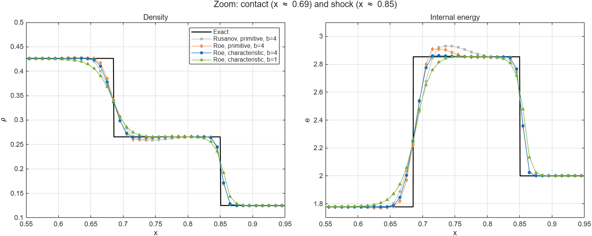
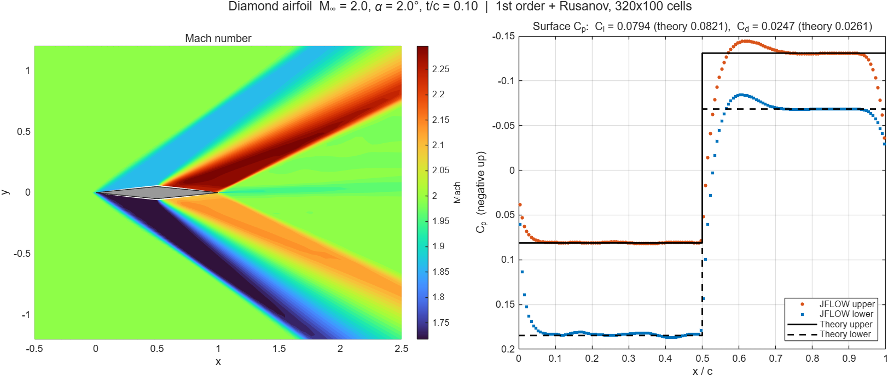
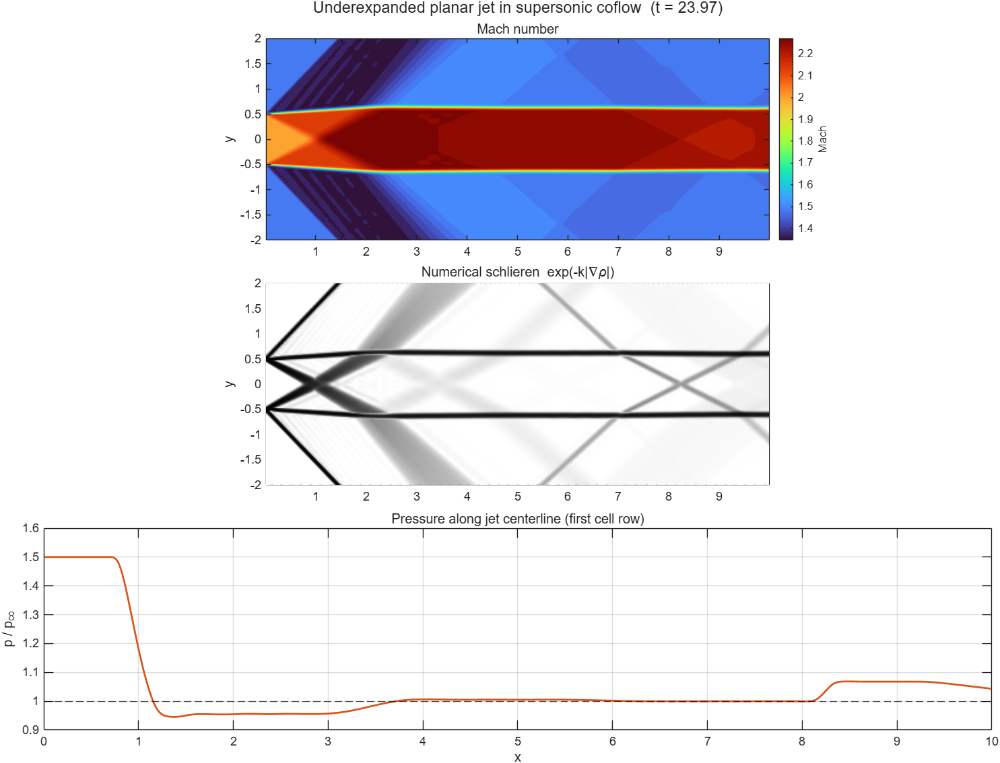
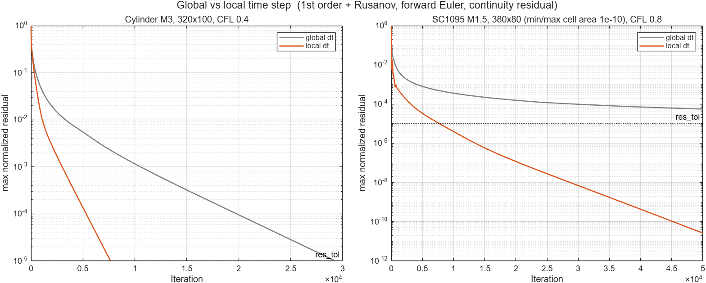

# JFLOW

2D compressible Euler solver — cell-centered finite volume on structured curvilinear grids, written in Fortran.
Reads PLOT3D grids (e.g. from Pointwise).


## Features

- Riemann solvers: Rusanov, Roe
- MUSCL (κ-scheme, minmod) with characteristic-variable reconstruction
- SSP-RK3 time integration, local time stepping for steady flows
- BCs: slip wall, symmetry, supersonic inlet, outlet, Riemann-invariant farfield
- Automatic C-grid wake cut / O-grid seam detection
- OpenMP

## Build & run

```
build.bat release omp
.\main.exe <case folder>
```

A case folder contains `grid.in` and `flow.in`. Results are written to the same folder:
`<output>_result.dat` (Tecplot), `<output>_line.dat`, `<output>_residual.dat`.

## Input

`grid.in`
```
$block-1 = airfoil.x            # PLOT3D file, or: cartesian ni nj xmin xmax ymin ymax
$form-1  = 1                    # 0 binary, 1 ASCII
$bc-1-3  = 110 49 305           # face (1 imin, 2 imax, 3 jmin, 4 jmax) = code [node range]
$bc-1-4  = 200 freestream
$output  = airfoil
```
BC codes: `110` wall, `200` farfield, `210` inlet, `220` outlet, `300` symmetry.
Faces without a BC are connected automatically if they coincide with another face.

`flow.in`
```
$steady   = 1                   # 1 steady, 0 unsteady ($t_end)
$max_iter = 40000
$res_tol  = 1.0e-5
$local_dt = 1
$cfl      = 0.8
$sigma    = 1                   # 0 first order, 1 MUSCL
$kappa    = 0.3333333333333333
$b        = 1                   # minmod compression
$flux     = roe                 # rusanov | roe
$state-freestream = 1.0  0.7287  0.0320  0.7142857142857143    # rho u v p
$initial  = freestream
```
Nondimensionalization: ρ = 1, p = 1/γ → speed of sound 1, so `u = M cos α`, `v = M sin α`.
All keys are listed at the top of [case_setup.f90](case_setup.f90).

## Example: Sod shock tube

`grid.in`
```
$block-1 = cartesian 101 21 0.0 1.0 0.0 0.2
$bc-1-1  = 220
$bc-1-2  = 220
$bc-1-3  = 220
$bc-1-4  = 220
$output  = sod
```

`flow.in`
```
$steady   = 0
$t_end    = 0.2
$cfl      = 0.4
$line_row = 10
$sigma    = 1
$kappa    = 0.3333333333333333
$b        = 1
$flux     = roe
$state-left  = 1.0    0.0  0.0  1.0
$state-right = 0.125  0.0  0.0  0.1
$initial  = right
$region-1 = left  *  0.5  *  *
```

## Results

RAE 2822, M 0.7294, α 2.516° — Euler vs. Airbus pETW experiment ([NWTF](https://www.nwtf.ac.uk/dataset/2687/)), top figure.

Sod shock tube, 100 cells — primitive vs. characteristic reconstruction.



Diamond airfoil, M 2.0, α 2° — vs. shock-expansion theory.



Underexpanded planar jet in supersonic coflow.



Convergence with global vs. local time step.


